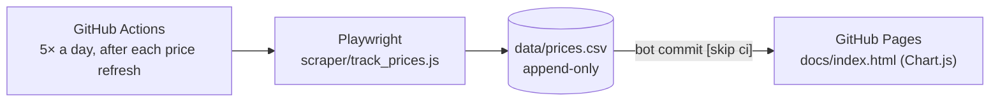

# Apartment Price Tracking

**One building's asking rents, every few hours, on a chart a friend can open.**

Tracks every available unit at The Westerly on Lincoln (Marina del Rey) five
times a day and plots the history, so a friend could watch the price of the
unit they wanted without checking the leasing site by hand.

**Live dashboard:** https://ethanalong.github.io/ApartmentPriceTracking/

<sub>Node · Playwright · GitHub Actions · GitHub Pages · Chart.js · 22,000+ rows since 2026-05-28</sub>

> The successor, [dtla-rent-tracker](https://github.com/EthanAlong/dtla-rent-tracker),
> takes the same shape to eight buildings without a browser.

## How it works



## Decisions worth keeping

- **Read `data-*` attributes, not page text.** The leasing page ships every
  unit's rent, size, floor plan and move-in date as attributes; a first
  version that parsed visible text was thrown off by unrelated "Apartment"
  labels elsewhere on the page.
- **Don't click "Load more".** All units are already in the page; the button
  only reveals them.
- **Scrape everything, filter in the dashboard**, so new questions (another
  floor plan, two-bedrooms) need no re-scrape.
- **Cron times follow the site's refresh schedule** (about 30 minutes after
  each price update, Pacific time), plus an evening fallback.

## Run it

```bash
npm install
npm run track      # one scrape, appends to data/prices.csv
npm run discover   # dump the rendered page to scraper/ when the site changes
```

Details and history: [`CLAUDE.md`](CLAUDE.md).
